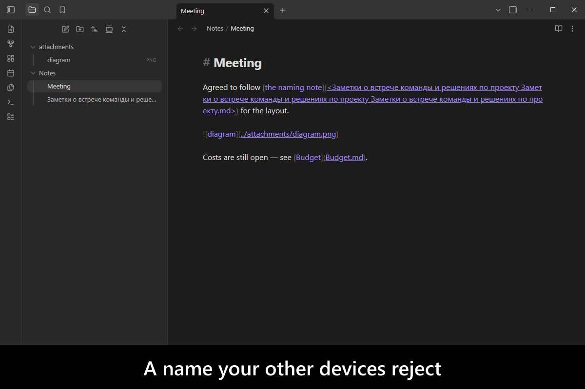
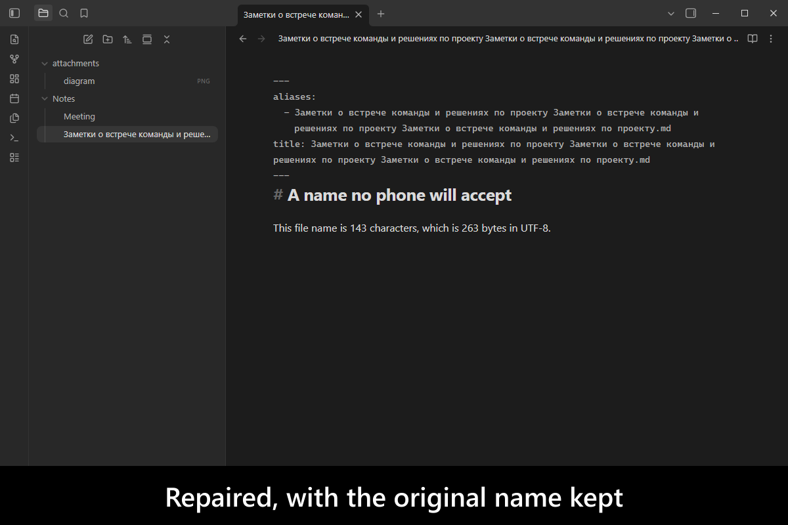
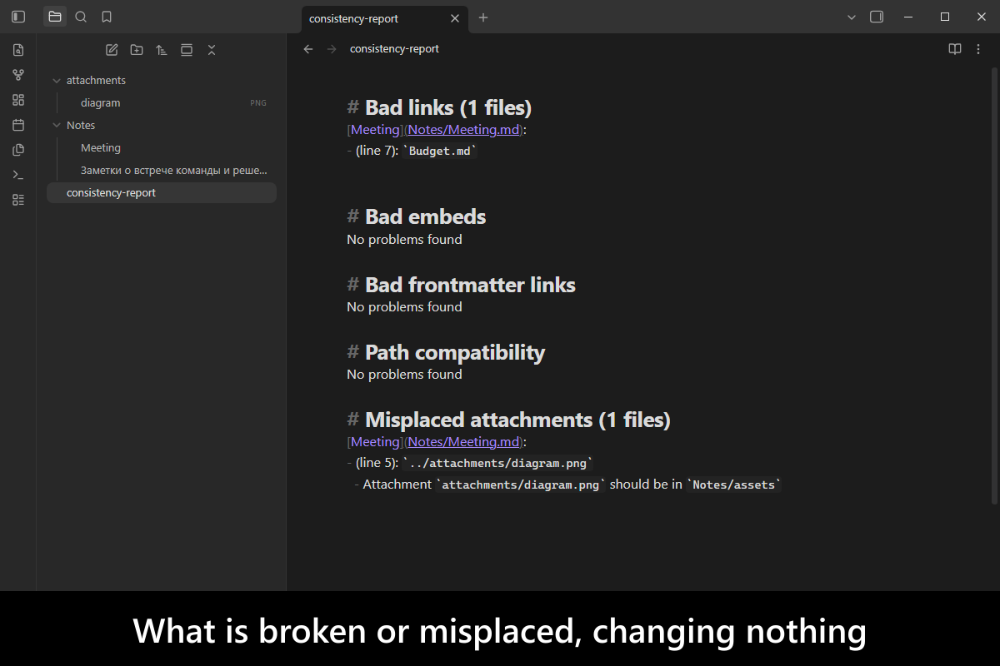
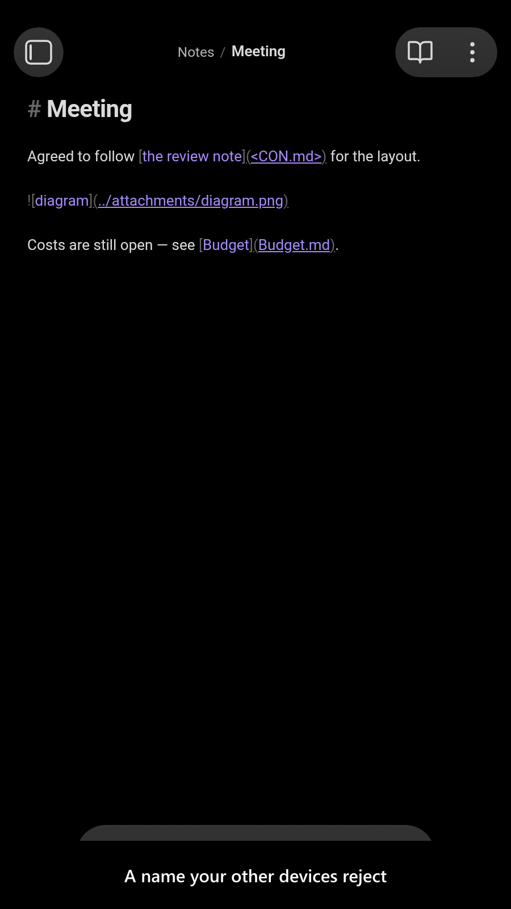
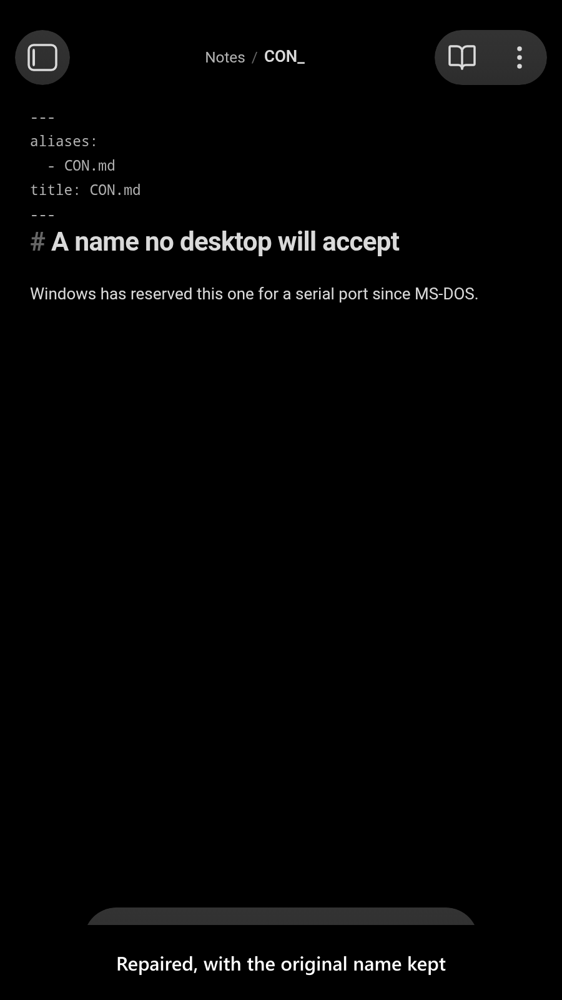
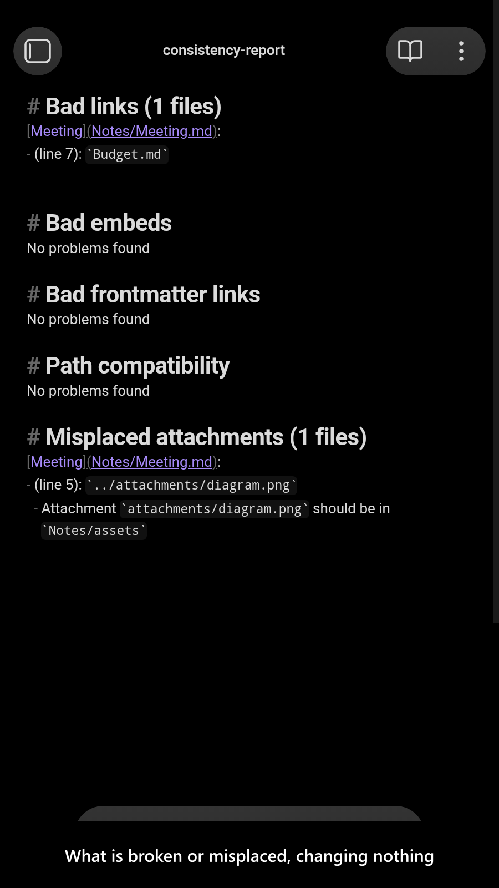

# Consistent Attachments and Links

   

[Obsidian](https://obsidian.md/) resolves links with a clever search that only Obsidian has, so a vault can be perfectly navigable inside it and full of dead links the moment you open a note anywhere else — in another editor, published to GitHub, or exported as a folder.

This plugin makes that visible: it reports every link whose written path does not lead to its target, repairs a broken link's path when you pick the file it meant, and repairs names a platform you sync to would reject. It never rewrites a link into a style, moves an attachment or cleans up folders: where those matter, it reports and leaves the change to you.

> [!IMPORTANT]
>
> This plugin requires [Advanced Rename and Delete Handler](https://obsidian.md/plugins?id=advanced-rename-and-delete-handler), which handles renames and deletions for the whole vault since **4.0.0**. This plugin installs it in one click, which changes nothing on its own, and offers to hand your old settings across.

<!-- Separates the callouts; without it markdownlint reads them as one blockquote. -->

> [!WARNING]
>
> **Fix incompatible paths** renames files and folders across the whole vault, so it is crucial that you back up your vault before running it!

<!-- markdownlint-disable MD033 -->

More screenshots

<!-- markdownlint-enable MD033 -->

## Demo vault

**The documentation is a demo vault.** Every feature has a note that explains what it does and why you would want it, with example notes to run it against.

**[Start reading here](<./demo-vault/00 Start.md>)** — it is plain markdown, so it works on GitHub with nothing installed.

A copy of the vault ships with every release. You can access it via any of the following:

1. Running the **`Consistent Attachments and Links`: Open demo vault** command.
2. Downloading `consistent-attachments-and-links-demo-vault.zip` from the [Releases](https://github.com/dy-sh/obsidian-consistent-attachments-and-links/releases). It unzips into a single `consistent-attachments-and-links-demo-vault-<version>` folder.
3. Browsing its source in [`demo-vault/`](./demo-vault/README.md) in this repository.

## What it does

- **Check vault consistency** reports, changing nothing, bad links, embeds and frontmatter links, attachments outside their note's attachment folder, and names a platform you sync to would reject. [03 Check vault consistency](<./demo-vault/03 Check vault consistency.md>)
- **Fix broken links** offers, with its evidence, the file each broken link most likely meant, and repairs the link's path on your click. [09 Fix broken links](<./demo-vault/09 Fix broken links.md>)
- **Fix incompatible paths** repairs the names and paths that Windows, Android, Linux, macOS or iOS would reject, keeping the original name and every link. [08 Keep paths valid on every platform](<./demo-vault/08 Keep paths valid on every platform.md>)
- **Every command**, and where the ones that left went. [07 Commands](<./demo-vault/07 Commands.md>)
- **Settings**, including which platforms the path repair enforces. [05 Settings](<./demo-vault/05 Settings.md>)
- **Obsidian's own settings matter too** — link format, attachment location — and the vault explains which ones to change and why. [06 Recommended Obsidian settings](<./demo-vault/06 Recommended Obsidian settings.md>)

## Where the old features went

<!-- The span keeps #attachment-subfolder-setting resolving: plugin versions before 3.0.0 link to it. -->
<!-- markdownlint-disable MD033 -->

Link conversion, link-path rewriting, attachment collecting, rename and delete handling, `Delete empty folders`, `Reorganize vault` and the `Attachment Subfolder` setting moved to other plugins or were retired: [Where the old features went](<./docs/where-the-old-features-went.md>) maps each one to the plugin that owns it now.

<!-- markdownlint-enable MD033 -->

## See also

[My other Obsidian resources](https://github.com/mnaoumov/obsidian-resources)

| Plugin | Features | How `Consistent Attachments and Links` differs |
| --- | --- | --- |
| [`Attachment Audit`](https://community.obsidian.md/plugins/attachment-audit) | Unused, duplicate, oversized, misnamed and misplaced attachment cleanup | Narrower attachment audit: reports placement against configured folders; also link/name checks |
| [`Broken Links`](https://community.obsidian.md/plugins/broken-links) | Broken target, heading and block browser; folder/file/link views | Broader checks: file names and path validity; link repair |
| [`File name length limit`](https://community.obsidian.md/plugins/file-name-length-limit) | Live naming warnings; report includes case collisions; no renaming | Broader audit and repair: renames invalid files; checks links |
| [`Find orphaned files and broken links`](https://community.obsidian.md/plugins/find-unlinked-files) | Reports orphaned/empty files, folders and uncreated notes; delete/archive | Complementary audit: validates written paths against their targets |
| [`Link Doctor`](https://community.obsidian.md/plugins/link-doctor) | Broken-link dashboard; Obsidian name matching; empty notes; no edits | Broader path checks: reports non-resolving written paths; repairs links |
| [`Safe Filename Linter`](https://community.obsidian.md/plugins/safe-filename-linter) | Invalid/troublesome filename character lint | Broader checks: per-platform name/path lengths and links |
| [`Sync-safe file names`](https://community.obsidian.md/plugins/sync-safe-file-names) | Automatic cross-device character replacement on create/rename | Broader repair: on command; lengths, reserved names, Unicode form; original names retained |
| [`Vault Link Check`](https://community.obsidian.md/plugins/vault-link-check) | Typo/alias suggestions; separates planned notes from broken links | Alternative repair evidence: git history, renamed folders and aliases; click to apply |

Last searched for similar plugins on 2026-10-26.

## Installation

The plugin is available in [the official Community Plugins repository](https://community.obsidian.md/plugins/consistent-attachments-and-links).

### Beta versions

To install the latest beta release of this plugin (regardless if it is available in [the official Community Plugins repository](https://community.obsidian.md) or not), follow these steps:

1. Ensure you have the [BRAT plugin](https://community.obsidian.md/plugins/obsidian42-brat) installed and enabled.
2. Click [Install via BRAT](https://intradeus.github.io/http-protocol-redirector?r=obsidian://brat?plugin=https://github.com/dy-sh/obsidian-consistent-attachments-and-links).
3. An Obsidian pop-up window should appear. In the window, click the `Add plugin` button once and wait a few seconds for the plugin to install.

## Debugging

By default, debug messages for this plugin (id: `consistent-attachments-and-links`) are hidden.

If you need to enable them refer to the [documentation](https://mnaoumov.dev/obsidian-lib/guides/debugging/).

## Changelog

All notable changes to this project will be documented in the [CHANGELOG](./CHANGELOG.md).

## Contributing

Contributions are welcome — see [CONTRIBUTING](./CONTRIBUTING.md) to get set up.

## Support

<!-- markdownlint-disable MD033 -->

<!-- markdownlint-enable MD033 -->

## License

© [dy-sh](https://github.com/dy-sh/)

Maintainer: [Michael Naumov](https://github.com/mnaoumov/)
